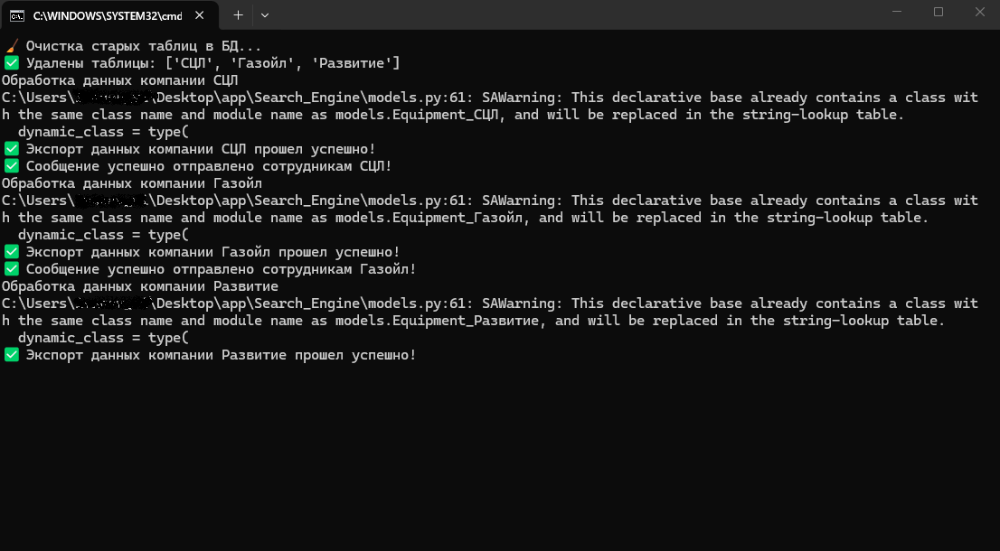

# Search Engine 
Программа предназначена для работы с файлом формата .xlsx. По наименованию организации, указанному в .env файле, программа ищет нужную вкладку в таблице base.xls и производит сортировку оборудования с просроченными сроками поверки. В резельтате выполнения сортировки, отфильтрованные данные выносятся в отдельный файл exel.

# Содержание
- [Технологии](#технологии)
- [Использование](#использование)

# Технологии
- [Python](https://www.python.org/) 
- [SQLite](https://www.sqlite.org/docs.html)
- [SQLalchemy](https://www.sqlalchemy.org/)
- [pandas](https://pandas.pydata.org/)
- [numpy](https://numpy.org/)
- [emails](https://python-emails.readthedocs.io/en/latest/)

# Использование
## Шаг 1: Установка сервисов для запуска проекта

Если у вас установлены все программы описанные в этом шаге, переходите к шагу 2.

### Установка Python 
****
Если вы пользуетесь Linux то перед установкой новых приложений обновите списки пакетов в системе Linux

```
sudo apt update && upgrade
```
****

Для начала установите Python, если он у вас ещё не установлен с официального [сайта](https://www.python.org/downloads/windows/) если у вас система Windows или по этой [ссылке](https://www.python.org/downloads/macos/), если у вас macOS.
Для системы Linux как правило python уже предустановлен.

Для проверки устанолен ли python введите в командной строке:

* для Linux/Windows/macOS
```
python --version
```
* Результат выполнения:

```
Python 3.12.3
```
## Шаг 2: Клонирование репозитория

Клонируйте репозиторий проекта на свой компьютер

```
git clone https://github.com/VladislavDenk/Search_Engine.git
```

## Шаг 3: Создание виртуального окуржения и установка зависимостей

В дериктории проекта создаем и активируем виртуальное окружение.

* Создание виртуального окружения:

```
python -m venv .venv
```

или

```
pyhton3 -m venv .venv
```

* Активация виртуального окружения для Linux/macOS

```
source .venv/bin/activate
```

* Активация виртуального окружения для Windows

```
.venv\Scripts\activate.bat
```

* Установка зависимостей

```
pip install -r requirements.txt
```

## Шаг 4: Создание .env файла с секретными данными

В директории создаём файл .env командой для Linux/macOS:

```
touch .env
```

В директории создаём файл .env командой для Windows:
```
type nul > .env
```

Файл .env должен хранить в себе следующие данные
```
# host mail.ru для отправки сообщений
smtp_server_mail = "smtp.mail.ru"
# port mail.ru для отправки сообщений
smtp_port_mail = "465"

# email отправителя сообщений
sender_email = "your.email@example.com"

# пароль от почтового ящика отправителя для внешних приложений
# как получить этот пароль загуглите
# приведенный ниже пароль не действительный. Он приведен для наглядности того как он выглядет
password_sender_email = "Pn1TweXrgHthkhWD1PsZ2o"

# Наименования организаций, по которым необходимо составлять отчеты
teams = "СЦЛ,Газойл,Развитие"

# Адреса электронных почт, получателей
recipients_scl = "example1@example.ru,example2@example.ru,example3@example.ru"
recipients_gazoil = "example1@example.ru,example2@example.ru"
recipients_razvitie = "example1@example.ru,example2@example.ru,уxample3@example.ru"

# Тело сообщения
message = "<p>Здравствуйте! Тут вы можете написать свое сообщение.</p>"

```

## Шаг 4: Создание .env файла с секретными данными

Для запуска приложения в запустите файл находясь в папке с проекта командой:
```
python main.py
```
или 

```
python3 main.py
```

В ручную на Windows запустите файл <i><b>run_main.bat</i></b>

После запуска появится следующее окно с выводом процесса выполнения программы:



## Сотрудничество
Для отправки предложений или баг-репортов можете написать мне на электронную почту:

vladislavvivanov070@gmail.com

