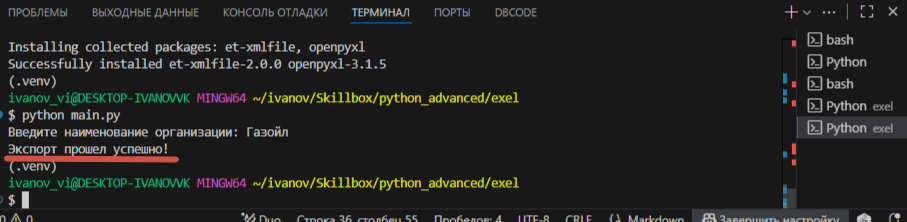
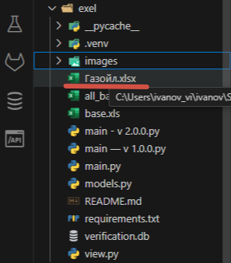
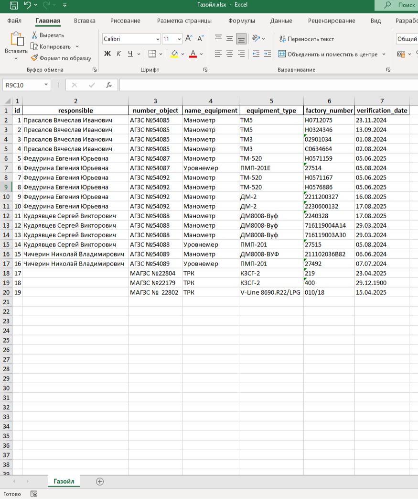

# Search Engine 
Программа предназначена для работы с файлом формата .xlsx. На основании введенной организации, программа ищет нужную вкладку в файле exel и производит сортировку оборудования с просроченными сроками поверки. В резельтате выполнения сортировки, отфильтрованные данные выносятся в отдельный файл exel.

## Содержание
- [Технологии](#технологии)
- [Использование](#использование)

## Технологии
- [python](https://www.python.org/) 

## Использование
Для корректной работы программы у вас должен быть установлен Python 3-й версии и библиотеки перечисленные в файле requirements.txt.
Для начала работы установите все необходимые библиотеки из файла requirements.txt следующим образом:
```
pip  install -r requirements.txt
```

Для запуска приложения в запустите файл находясь в папке с проекта командой:
```
python main.py
```
или 

```
python3 main.py
```

Далее приложение запросит ввести наименование организации, в которой необходимо произвести сортировку объектов. Наименование листа файла Exel долже совпадатьс введенными данными, для корректной работы.

Пример:


Таким образом называем листы при создании базы.

Следующим образом вводим интересующую нас организацию.


При правильном вводе наименования организации получаем следующее сообщение в консоле:



В это время в папке с приложением создается файл с именем как у наименования организации.


В этом файле находится вся интересующая нас информация об оборудовании, у которой просрочен срок поверки.



## Сотрудничество
Для отправки предложений или баг-репортов можете написать мне на электронную почту:

vladislavvivanov070@gmail.com

